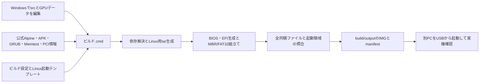

# PCInfo Classic 設計書

## 1. 目的と決定事項

更新日：2026-10-18。対象は `D:\作業フォルダ\20_Projects\06_pcinfo_classic`。

利用者の依頼は、共通リファレンスに沿うフォルダ整理と、Windows 11だけで開発できる環境への移行。Docker・WSLは使用しない。Windowsで編集、依存取得、OS・ドライバー・起動部を含むIMG生成、内部整合性検証を行う。別PCではUSB起動と実機診断を確認する。

既存IMGのアプリ部分だけを差し替える提案は、利用者の「完全にWin11で開発したい」という指定により取り下げた。新方式は既存IMGを入力にせず、空のIMGから生成する。AlpineやGRUB自体をソースコンパイルするのではなく、公式配布バイナリから起動IMGを組み立てる。アプリ本体は従来どおりAlpine Linux用シェルスクリプトとする。

作業の基準はGit HEAD `6cc99f9`。開始時点で追跡ファイルの変更はなかった。Windows移行と調査後の実装について利用者から「はい」の回答を得た。公開・GitHubへの送信・物理USBへの書込みは今回の対象外。公開バージョンは採番しない。

共通規則は[AI_START](../../../10_Data/10_Documents/98_アプリ作成のリファレンス/AI_START.md)と[構成・命名規則](../../../10_Data/10_Documents/98_アプリ作成のリファレンス/11_プロジェクト構成・命名規則.md)を参照する。共通指示のコピーを個別AI指示ファイルへ置かない。

## 2. 技術と役割

| 対象 | 技術・役割 |
|---|---|
| 開発PC | Windows 11、Windows版Python 3.12、専用`.venv/` |
| 診断アプリ | Alpine Linux上の`/bin/sh`とjq。PC Info、Memory Test、GPU Driver Check、Storage Health |
| OS入力 | Alpine standard ISOのカーネル・USB対応initramfs・modloop。初期設定は3.21.8 x86_64 |
| APK | 公式main/communityのAPKINDEXから依存閉包を解決し、パッケージとライブラリを取得 |
| 起動部 | GNU公式Windows版GRUB 2.14の生成ツールと、Alpine 3.24公式のGRUB 2.14-r0ターゲット部品でBIOS coreとx86_64 EFIを生成 |
| IMG | Python・PyFatFSによるMBR＋FAT32。物理ディスクを開かない |
| ISO読取り | PyCdlib。ISO形式の成果物は生成しない |
| Linux用tar | Python tarfileで所有者・実行権限・大文字小文字・リンクを保持。Windowsへ展開しない |
| 外部通信 | ビルド時の公式配布物・PCI情報取得。Windows標準curl、HTTPS使用 |

診断の表示、キー操作、GPU判定ルール原本の内容は維持する。ビルド方式に必要なLinux初期設定はテンプレート化する。既存の起動後のハードウェア操作をWindows側で実行しない。



## 3. 構成と入口

```text
06_pcinfo_classic/
├── README.md / LICENSE / .gitignore / .gitattributes
├── セットアップ.cmd / ビルド.cmd / 検証.cmd
├── requirements-dev.txt
├── .venv/                         専用Python・pipキャッシュ（Git除外）
├── src/                           Linux用の自作診断スクリプト・jq解析処理
│   └── boot/                      Linux初期設定・自動ログイン処理
├── data/gpu/                      GPU判定ルール4本
├── tools/
│   ├── setup_windows.ps1
│   ├── build_windows.py
│   ├── verify_windows.py
│   ├── pcinfo_build/              依存解決・取得・tar・IMG処理
│   └── packaging/
│       ├── build_config.json      OS・GRUB・パッケージ・起動引数
│       └── overlay/               Linux設定ファイルのテンプレート
├── tests/                         合成データによる回帰テスト
├── docs/                          本書・release-notes・GPU調査一覧
├── licenses/                      注意書き・ライセンス・ソース提供資料
├── .cache/verification/            検証専用の一時ファイル
└── build/                         Git除外
    ├── work/downloads/            取得物とURL・SHA-256の記録
    ├── work/windows/              Windowsツールとビルド中間物
    ├── work/previous/             実機確認前の復元用旧IMG
    ├── work/legacy_alpine/         移行前の中間物
    └── output/                    完成IMGとmanifestの唯一の出力先
```

通常の開発・ビルドはREADMEの3つのcmdを入口とする。カレントディレクトリに依存せず、スクリプトの場所からルートを求める。セットアップはPython 3.12の実行ファイルを明示指定できる。WindowsのグローバルGit設定やPATHを変更しない。

`config/`はアプリの動作設定用だが、現状必要ないため作らない。ビルド・保守設定は`tools/packaging/`に置く。`licenses/`は同梱元として維持する。空のassets、export等は作らない。共通処理の`common.sh`分割は今回の対象外。

## 4. ビルド経路と更新

1. 設定を検査し、同時ビルドをファイルロックで防ぐ。
2. 公式Windows版GRUBの生成ツールを設定したSHA-256と照合する。同じ上流版のターゲット部品はAlpine公式grub-bios/grub-efiから取得し、APKのチェックサムも照合する。部品の取得系列はOS本体と独立した設定項目にする。
3. Alpine ISOを公式公開SHA-256と照合し、カーネル・initramfs・modloopを取り出す。
4. main/communityのAPKINDEXからbaseと診断ツールの依存を解決する。未解決や衝突があれば失敗とする。
5. APKのcontrol checksumをindexと照合し、controlに記録されたdatahashも照合する。公式main indexは署名付きのまま起動媒体に置く。Windows側でOpenPGP署名検証を実装したとは扱わない。
6. Memtestのx86_64公式バイナリをEFI/Linux両形式として検査し、PCI情報からGPU表を生成する。
7. Linux用アーカイブ内でパッケージと自作コードを組み立て、属性・リンクと原本を照合する。
8. Windows版GRUBでBIOS coreとEFIバイナリを生成し、GRUB設定の構文を検査する。
9. 空のIMGにMBR、GRUB埋込み領域、FAT32と同梱ファイルを生成する。
10. IMGを開き直し、全ファイル・MBR・coreを照合してから完成品へ昇格する。

大容量の配布物はHTTPの範囲取得を使用し、結合後の全体チェックサムを必ず確認する。取得途中の`.part`を完成済みキャッシュにしない。ビルド一時領域は終了時に片付け、環境変数を復元する。取得キャッシュ・展開済みツールは再利用のため保持する。

`--offline`は既存の取得記録とハッシュを照合し、欠落があれば通信せず失敗する。`--refresh`はAPKINDEXとPCI情報を更新する。OSやGRUBの版は自動追従せず、build_config.jsonで明示変更する。GRUB更新時は既知のBIOS形式との一致と実機起動を確認する。APK v2形式を対象にしており、将来APK形式や上流の起動仕様が変わる場合はパーサー等の対応を検討する。

出力manifestには設定、取得URL・SHA-256、パッケージ一覧に対応する同梱内容、IMG全体のSHA-256を記録する。検証後の出力更新中に通常のファイル操作エラーが起きた場合は前回出力を復元する。電源断中の複数ファイル更新の完全な原子性は保証しない。検証時にはIMGとmanifestの一致も確認する。

## 5. 起動構成の変更と維持する仕様

従来はパーティション表のないFAT32 IMGと、BIOS用Syslinux・UEFI用GRUBを使用していた。Windows移行ではLBA 2048からFAT32を開始するMBR構成とし、その前の領域にBIOS用GRUB coreを埋め込む。BIOSとUEFIの両方が`boot/grub/grub.cfg`を使用する。

GRUBのMBRとcoreの配置は同じ版の公式ソース`include/grub/i386/pc/boot.h`、`include/grub/offsets.h`、`grub-core/boot/i386/pc/diskboot.S`の形式に基づく。物理ドライブへのGRUBインストールやWindowsの起動設定変更は行わない。生成EFIのSecure Boot署名は対象外。

USBラベル`PCINFO`、GPU向けカーネル引数、起動時の自動ログイン、`/opt/pcinfo/`内の診断コード・データ配置を維持する。公式ISO内のapks/.boot_repositoryを同梱し、alpine_repo=autoでローカルリポジトリを探索する。USBがsda1・sdb1等のどの名前になっても、固定のデバイス名一覧に依存しない。使用するinitramfs内のinitでもこの探索経路を確認した。

Memtestは従来の`grubenv`一回起動フラグを維持し、フラグを消してからEFIならchainloader、BIOSならlinux16で起動する。再起動後はPCInfoへ戻る仕様。Linux起動用コマンドはWindows版公式GRUBが持つ`linux`・`initrd`を使用する。

Linux初期設定のAPK導入は、解決済み依存を含めた全APKを明示してオフライン導入する。これによりcommunity由来のkexec-tools等も含める。kexecの既存バイナリ調整は内容を保持し、対象バイト列が上流変更でなくなった場合は黙って進めず停止する。

## 6. 移行と保護

GPUルール4本をsrcからdata/gpuへ、未解決GPU調査一覧をdocs/gpuへ移動した。メモと旧Copilot指示の必要な固有仕様を本書へ引き継ぐ。Docker設定、旧ビルド入口と空フォルダは新ビルドの確認後に除く。旧入口へ転送する互換コードは置かない。ライセンス文書内の参照先も現行へ直す。

移行前IMGのSHA-256：`1a72ad2f7b6e51a0cb7bdbda2cc218002ba13eb9d927a230a7d9c10d6b1e9442`。保持先はbuild/work/previous/pcinfo-classic.img。旧中間物はbuild/work/legacy_alpineに保持し、通常ビルドの入力にしない。新IMGの別PCでの実機確認が済み、復元不要と判断できた時点で削除可能とする。検証用コピーや調査用の一時ソースは今回の検証後に片付ける。

## 7. 引き継ぐ案件固有仕様と制約

- Alpine Linuxを対象とし、Tiny Core Linuxの情報を流用しない。
- 成果物はUSB用IMG。ISO形式の成果物を作らない。既存方式と同じく公式ISOを入力として読む。
- GPU個別判定はNVIDIA GTX 2xx以降とAMD HD 3000以降。pci.idsが単一名なら採用し、曖昧名だけ別判定する。
- CU・VRAM・クロック・PCIe幅等を優先し、根拠不足なら断定しない。今回ルール内容や調査一覧の項目を変更しない。
- GPU仕様変更時は既存指定のTechPowerUp等を確認する。2026-06-28メモの0x731f・0x687fは当時の記録であり、現在の実装全体を2件だけと解釈しない。
- Linux本体の既存`/tmp/`やMemtest用のUSBへの書込みは既存の実機動作に属する。今回Windowsビルドの保存先はプロジェクト内に統一するが、診断アプリの全実行時保存先まで共通規則へ全面適合済みとは表示しない。

## 8. ライセンスと根拠

既存診断コードはMIT。Alpine APKはパッケージごとのライセンス、GRUBはGPL-3.0-or-later、Memtest86+はGPL-2.0-only、pci.idsはGPL-2.0-or-later又はBSD-3-Clause。APK由来の正確な版とライセンスは生成するBUNDLED_PACKAGES.tsvとSOURCE_LOCATIONSで管理する。

Windowsビルドの版比較モジュールversions.pyはapk-tools v2.14.6由来でGPL-2.0-only。著作権表示・出典をコードへ残し、ライセンス本文をlicensesに保持する。既存コード全体のライセンスを改変する意味ではない。

- [GNU GRUB公式Windows版の案内](https://lists.gnu.org/archive/html/grub-devel/2026-01/msg00029.html)
- [GNU GRUB公式マニュアル](https://www.gnu.org/software/grub/manual/grub/grub.html)
- [Memtest86+公式の起動形式](https://github.com/memtest86plus/memtest86plus/blob/main/README.md)
- [Alpine公式リリース情報](https://alpinelinux.org/releases/)
- [apk-tools版比較の出典](https://github.com/alpinelinux/apk-tools/blob/v2.14.6/src/version.c)
- [PyFatFS公式API](https://pyfatfs.readthedocs.io/en/stable/pyfatfs.PyFatFS.html)

## 9. 確認結果

Windowsでのセットアップ、通常ビルド、オフラインビルド、検証.cmdは合格。回帰テスト9件で、依存解決、衝突・欠落検知、Alpineの版比較、Linux属性とリンク保持、GPU表、キャッシュ破損検知、MBRとFAT内の改変検知、出力更新失敗時の復元、自分の印がある一時物だけを削除する動作を確認した。

公式配布物を取得し、Windowsだけで空のIMGから生成した。移行前IMG・旧中間物をビルド入力にしていないことを参照元から確認した。別のカレントディレクトリからのビルド・検証も合格。62個の同梱ファイル、MBR、BIOS core、IMG全体のSHA-256を照合した。診断アプリ側のLinux実行ファイルはELF32/64を解析し、ローダー・必要ライブラリがアーカイブ内に存在することも確認した。

確認した完成IMG：536870912バイト（512MiB）。SHA-256：`1cfc83bbd51a742e09d49d0023f3d4d1e23b0ecd39abafb12815129a5539b54c`。ハッシュはビルドごとのmanifestを正とする。タイムスタンプ等を固定したビット単位の再現ビルドを保証するものではない。

元のIMGのハッシュ一致を確認。GPUルール4本・調査一覧は内容一致。自作診断スクリプト7本は、menu_gpu.shの旧ビルド設定参照コメントを除き内容一致を確認した。

GNU Windows配布物2.14に含まれるBIOS用kernel.imgは、リンクアドレス不一致で生成ツールに拒否された。この部品は使わず、同版のAlpine公式ターゲット一式を使用してBIOS・EFIの両生成に成功した。生成ツールとターゲットの上流版が一致しない場合は停止する。修正したバイナリを手製で流用したり、検査を迂回したりしていない。

PyFatFSが使うfsのpkg_resources非推奨警告だけは、互換性を確認したsetuptools 80.9.0への固定を条件に抑制している。他の警告を除外する設定ではない。

別PCでのBIOS/UEFI起動、GPU・ストレージ・Memtestの実機確認は未実施。Windowsで内容検証が通ったことだけで機器対応の合格とはしない。既存IMGと中間物は実機確認待ちのため保持する。


## 10. 変更範囲の品質・安全性

評価区分はC。外部取得のWindows生成ツールを実行し、起動コードとLinux用のroot実行環境を作るため。Windows側は通常権限のファイル生成に限定し、管理者用GRUBインストール処理や物理ドライブ操作を組み込まない。一般公開・第三者への配布は今回行っていない。専門的な監査や全依存の脆弱性診断は今回の移行確認には含めず、全体の安全性認証とは扱わない。別PCの実機試験は利用者指定の確認工程として残す。

| 観点 | 確認した範囲と結果 |
|---|---|
| SEC-01/04 | 外部配布物はHTTPS、既知のGRUB配布物は固定SHA-256。APKはcontrol checksumとdatahashを照合。コマンドは引数配列で実行し、不必要なシェルやLinux環境を介さない |
| SEC-03/05 | ZIP・APKの出力パスを検証。IMG出力先は固定。通常の出力更新失敗で前回分が復元されること、無印の一時フォルダを削除しないことを回帰テストで確認 |
| SEC-06 | ビルド処理はプロジェクトのソース・設定と公開配布物を読む。Windowsのハードウェア情報収集、利用者ファイルの外部送信、物理USBへの書込みは行わない |
| SEC-07 | Python直接・間接依存をrequirements-dev.txtへ固定。実際の配布物URL・ハッシュ・GRUB部品版をmanifestへ記録。将来の上流仕様変更まで適合を保証しない |
| QLT-01/04 | 取得、Alpine依存解決、版比較、tar生成、ELF検査、IMG生成をモジュールに分離。役割・前提・互換性の理由をコメントと本書へ記録 |
| QLT-05/06 | 3つのcmdで環境準備・ビルド・検証を再実行可能。9件の固定合成データによるテストと、完成IMGの全ファイル照合が合格 |
| QLT-07/08 | Docker設定・旧入口・統合済みメモ・旧個別AI指示・空フォルダ・調査用コピーを整理。GPU判定内容と診断処理の本体を保持 |

旧IMGと旧Alpine中間物は復元用に保持する。公式配布物からIMGを組み立てるWindows移行は完了。実機の起動・診断結果は未確認であり、別PCで確認後に本書へ追記する。現在の対象範囲と今回の整理は次節に記録する。

## 11. 現在の開発範囲と構成の整理（2026-10-18）

利用者と現行処理を確認し、必要な改修はAlpine標準ドライバの読み込み設定と動作オプションの変更であることを確認した。利用者の「ドライバのソースビルド用に追加したものは不要だから整理して、今の方式でWindows11だけで開発・ビルドできる構成にして」という依頼により、ソースビルドの追加作業は取り下げた。未完了の開発工程として残さない。

Windows版Python 3.12とプロジェクト専用.venvを使用する。入口はセットアップ.cmd・ビルド.cmd・検証.cmdの3つとし、Windows版GRUB等の必要な生成ツールはビルド時に照合して取得する。Docker・WSL・Linux仮想マシン・Cygwin・MSYS2・LLVMへの依存はない。アプリの実行OSは引き続きAlpine Linuxで、USB起動・実機診断の確認先は利用者指定の別PC。

公式ISOのvmlinuz-lts・initramfs-lts・modloop-ltsをそのまま同梱し、起動モジュールと動作オプションをtools/packaging/build_config.jsonで管理する。ドライバの追加・改造・再コンパイルは現行IMGの工程に含めない。今回、Alpineの版、GPU向けの読み込み指定、診断スクリプトとGPU判定データは変更しない。

試験用ドライバ、専用のcmd・Python・Kbuild補助処理・固定設定・4件の専用テストを削除した。関連するLLVM・Cygwin・MSYS2環境、Linux開発ヘッダーとソース、取得キャッシュ、調査用ファイルもプロジェクト内の専用領域から除去した。Pythonのzstandard依存も削除・アンインストールした。通常IMGの入力キャッシュ、必要なWindows版GRUB、移行前の復元用IMG、旧Alpine中間物は保持する。

将来の同梱済みドライバの有効化や設定変更は、このWindowsビルドで行う。未同梱ドライバやファームウェアの追加が必要な場合は、Alpine側の提供状況とカーネル版を確認し、OSの更新又は同梱処理の変更を案件ごとに行う。設定文字列への追記だけで未同梱ドライバを追加できるとは扱わない。

整理後の確認：Windows上でセットアップ.cmd、ビルド.cmd --offline、検証.cmdを実行し、すべて終了コード0。回帰テスト9件とIMG全体・全同梱ファイルの照合が合格。IMGは536870912バイト、同梱ファイルは62件。現行ビルドが使用する取得物61件を残し、専用の取得物134件・開発環境と調査ファイル約5GBを削除した。診断コード・GPUデータ・設定と復元用IMGの21ファイルは整理前のSHA-256と一致。別PCでのUSB起動・実機診断のみ未確認。

## 12. ファイル構成の整理（2026-10-18）

利用者の「ファイル構成をアプリ作成のリファレンスに基づいて整理」という依頼を今回の変更範囲とする。基本配置は現行を維持し、自作のLinux起動処理2本を配布設定からsrc/boot/へ移す。設定テンプレートはtools/packaging/overlay/、ビルド設定はtools/packaging/build_config.json、GPU参照データはdata/gpu/、検証コードはtests/、環境準備・ビルド・検証の入口はtools/と直下のcmdに置く。不要な空のconfig・assets・export等は作らない。

| 変更前 | 変更後 | IMG内の配置（維持） |
|---|---|---|
| tools/packaging/overlay/etc/local.d/00-pcinfo-setup.start | src/boot/setup.sh | /etc/local.d/00-pcinfo-setup.start |
| tools/packaging/overlay/usr/sbin/autologin | src/boot/autologin.sh | /usr/sbin/autologin |

ファイル内容、IMG内の配置・実行権限、起動順、診断機能は変更しない。ビルド側の同梱元を更新し、起動処理も原本照合の対象に含める。移動元への互換コードを残さず、空になった専用ディレクトリを除く。READMEと本書の構成図を更新し、未公開の変更履歴は一つの見出しへ集約する。

確認方法：移動前後のソース内容と、既存IMG・再生成IMGのapkovl全エントリの内容・属性・リンクを比較する。Windowsのオフラインビルド、既存9件の回帰テスト、IMG整合性検査を行う。復元用の旧IMGと旧Alpine中間物は実機確認待ちのため保持する。Linux実行時の保存先や画面操作の変更は今回の対象外。

確認結果：ビルド.cmd --offlineと検証.cmdは終了コード0。9件の回帰テスト、IMGの全同梱ファイル・起動領域・全体SHA-256の検査に合格。移動対象を含むソース・参照データ・設定・復元用IMGの31ファイルが整理前と一致し、apkovl内の全149項目の内容・実行権限・所有者・リンクも一致した。移動元のファイルと空ディレクトリを除去し、移動元の探索や互換転送は残していない。照合用の一時記録は確認後に片付けた。公開版は採番せず、未公開履歴を一つに集約した。

変更範囲のQLT-01/02/04/07/08（役割・命名・文書・片付け・限定した変更）とSEC-05（移行対象とデータ保護）は、配置・参照の確認と上記の内容照合で確認した。Windowsビルドの保存先・外部通信・権限・依存関係と、Linuxでの画面・診断処理は変更していない。別PCでのBIOS/UEFI起動と実機診断は引き続き未確認。

## 13. 診断処理の改善（2026-10-18）

利用者から改善方針の実装指示を受けた。GPUの既存判定ルール・取得手段を維持し、名称はGPU Driver Check、日本語化は行わない。その後の「ビルドはまだいいや修正まで」に従い、今回IMGを再生成しない。既存の完成IMGとmanifestは変更せず、今回のソース修正がまだ入っていない成果物として扱う。

| 対象 | 実装する動作・受入条件 |
|---|---|
| Storage Health | smartctlのJSONと終了コードでGood/Caution/Bad/Unknownを判定し、理由を表示する。取得失敗・情報不足をGoodにしない。SATA/SAS/NVMeの既存情報表示を維持し、jqを実行依存に追加する。SSD寿命は意味を限定できる属性だけを採用する |
| GPU識別 | 既存のPCI ID・名称・CU/VRAMルール原本を変更しない。実際のPCIアドレス・DRM cardとの対応でCU/VRAMログを取得する。単一AMD GPUのCUログ、単一GPUのVRAMログは従来のアドレスなし形式も使用する。複数GPUで対応不明な情報だけでは製品名を断定せず、元の候補名を残す |
| GPU Driver Check | 初回表示は情報確認のみ。rでモジュール読み込みを明示実行、qで戻る。画面表示用ドライバの強制解除・PCI再プローブは行わない。負荷・VRAM故障検査は追加しない |
| Memory Test | 繰返し実行・Escで再起動・次回PCInfoへ戻る案内へ修正する |

代表表示は英語の[GPU Driver Check]、GPU情報・Driver・DRM devices、末尾の「r: Load missing drivers   q: Back」。通常表示ではドライバを変更しない。Storage Healthは「Health Status: Bad」「Reason: SMART reports failing health」、情報不足時は「Health Status: Unknown」と理由を表示する。既存のTTY1・ANSI表示とキー操作を使用する。

確認は固定サンプルを使った診断解析の単体テスト、既存ビルド処理の単体テスト、ソース・依存・同梱設定の静的確認まで。実機のドライバ読み込み、表示、SMART取得とMemtest遷移は別PCで確認する。IMG生成・成果物の更新は利用者が再開を指示した後に行う。

実装結果：SMART解析とAMD CU・VRAMログ解析をjqへ分離し、同梱元と照合対象へ追加した。現行の配置はsrc/smart_health.jqとsrc/gpu_logs.jq（15項で共通化）。KFDのdomain/location_idとsimd_count/simd_per_cuからCU数を取得する経路を追加し、既存ログ形式を代替経路として残した。DRM実パスの正規化とPCIドメイン保持も修正した。単一GPUで得られていた正当な情報を捨てない設計で、GPUルール4本はGit HEADの原本とバイト一致。情報を対象へ結び付けられない複数GPU環境で、以前の誤った機種名を再現することは互換性要件としない。

Storage Healthはsmartctl 7.4のsmart_status.passed、終了ビット、ATA属性、NVMe警告から判定する。確認できた異常をBad、取得不完全・全体判定欠落をUnknown、警告をCautionとし、Goodは全体判定合格時だけに限定する。残寿命はNVMe percentage_usedと意味を限定したSMART属性だけを使い、Wear_Leveling_Countや予備領域の残量を寿命へ換算しない。温度・書込み量・電源投入・エラー情報の表示と、USBを健康確認対象から外す従来の仕様を維持する。

Linux側の実行依存はAlpine版jq 1.7.1-r0とonigurumaを追加する設定とした。既存APKINDEXだけを読んだ依存解決は53件で成功したが、今回APKの取得・展開・IMG組立ては行っていない。次回は通常ビルドで追加APKを取得する。Windows側はjq Python binding 1.12.0で実際のjqソースを検査し、Tree-sitterでシェル構文とGPU操作の到達経路を静的検査する。これらは.venv内の開発依存で、IMGへPython環境を同梱しない。

検証.cmd --tests-onlyを追加した。この指定では完成IMGを検証せず、単体テストだけを実行する。通常の検証.cmdでは完成IMGのハッシュ・構造に加え、現在のビルド設定・診断原本・GPUルール・jqソースとの一致も調べ、古いIMGの検査を現在の修正の合格として扱わない。

確認結果：検証.cmd --tests-onlyが終了コード0、18件すべて合格。SMART 23例、CUログ14例、VRAMログ8例、不正JSON 3例を検査。AMDルール37行の全CU数について従来2形式・PCI付き形式の計111通りで取得を確認。シェル9本と.profileに構文エラーがなく、初回表示の呼出し経路にモジュール変更がないこと、復旧がrキーの分岐に限定されること、強制解除・PCI再プローブの書込みがないことを構文木で確認した。Python構文とgit diff --checkも合格。

Windowsの既存sh.exeは、サンドボックス外での再試行を含めNtCreateDirectoryObjectのアクセス拒否で起動しなかったため、シェル全体の実行試験は行っていない。jq解析の単体実行とシェルの静的検査を、Linux実機確認の代わりとは扱わない。KFD・sysfsの実情報取得、実機ドライバ操作、TTY表示・キー操作、SMART取得とMemtest遷移は未確認。

完成IMGのSHA-256は従前の`1cfc83bbd51a742e09d49d0023f3d4d1e23b0ecd39abafb12815129a5539b54c`、復元用IMGは`1a72ad2f7b6e51a0cb7bdbda2cc218002ba13eb9d927a230a7d9c10d6b1e9442`のまま。今回のソース修正を含む新しいIMGはまだ作っていない。

根拠：[smartctl 7.4のJSONと終了コード](https://github.com/smartmontools/smartmontools/blob/RELEASE_7_4/smartmontools/smartctl.8.in)、[KFD topologyの公開項目とPCI対応](https://github.com/torvalds/linux/blob/v6.12/drivers/gpu/drm/amd/amdkfd/kfd_topology.c)。変更範囲のSEC-03/05/08とQLT-01/04/05/06は固定例と静的検査で確認し、実機に依存する判定は未確認として残す。通信先・実行権限・物理ディスク操作は増やしていない。公開番号は採番しない。

## 14. 起動・異常時処理・入力照合・GPU表示の改善（2026-10-18）

利用者は追加評価の項目2〜5の改善を指定した。項目1は「複数USBは接続しない」という運用条件とし、媒体の探索方式は変更しない。接続するUSBはPCInfo起動用の1本だけとする。今回もソース修正・単体テスト・静的確認までで、IMGの生成・更新は行わない。

| 対象 | 変更仕様と確認方法 |
|---|---|
| 初期設定 | USB・APK欠落、導入失敗、必須コマンド不足をエラーにする。実行環境内の/opt/pcinfo/.cache/runtime/boot-statusへ状態を残し、準備が完了していなければ診断メニューへ進ませない。英語で理由とrによる再試行・qによる終了を表示する |
| Memtest | キー取得の失敗をEnterとして扱わない。再起動要求の失敗を表示し、要求後も15秒以内に再起動しなければエラーへ戻す。失敗時は可能な範囲でMemtest一回起動フラグを取り消す |
| 入力照合 | 診断コード・データ・Linux設定テンプレート・ビルド処理・依存定義・ライセンスのファイル一覧とSHA-256をmanifestへ記録し、追加・削除・変更を検出する。ビルド開始・終了時の入力に差分があれば出力更新を止める。記録のない旧IMGは再ビルドを要求する |
| GPU表示 | 情報表示と復旧結果をページ送りにする。途中ページでもqで戻れ、rは明示したときだけ実行する。通常の確認からドライバ状態を変更しない |

代表表示は[Startup setup failed]・失敗理由・「r: Retry setup   q: Shutdown」。GPU Driver Checkは途中ページで「Enter: Next page   r: Load missing drivers   q: Back」、最終ページでr/qを表示する。既存の英語TTY表示を使用し、日本語化はしない。

確認はWindows上の入力照合の単体試験、既存診断解析テスト、シェル構文・操作境界の静的検査で行う。Linuxシェル実行と実機の失敗再現は別PCでの確認事項として残す。

実装結果：初期設定の開始時にboot-statusを未完了へ戻し、USB・APK・導入結果・必須コマンドを検査してからreadyを記録する。menu.shはreadyを確認するまで診断メニューへ進まず、失敗理由と再試行・終了操作を表示する。read_keyは正常なEnterとゼロバイト読取り・コマンド失敗を区別し、TTY状態を戻して失敗を返す。Memtestは失敗した読取りから開始せず、再起動要求が失敗又は15秒経過した場合はgrubenvの取消しを試みて理由を表示する。取消しに失敗した場合もその旨を理由に含める。

入力記録はtools/pcinfo_build/inputs.pyへ分離した。src・data・licenses・tools/packaging・ビルド用Python・依存定義・セットアップとビルド入口等を対象とし、docs・tests・キャッシュ・完成品は含めない。生成後の入力照合が通ってからmanifestへsource_inputsを記録し、出力を更新する。記録内のパスを使って任意ファイルを開かず、現在の既知の入力を列挙して比較する。旧形式は検証を省略せず再ビルドを要求する。

GPUの情報表示と復旧処理の出力は既存のページ分割処理へ渡す。GPU用の案内とr/qを返す操作を追加し、途中・最終ページから操作を選べるようにした。一時ページ領域を作れない場合はメモリ上のページ送りへ切り替える。通常のPC Info・Storage Healthのページ送りも保持する。

検証.cmd --tests-onlyは終了コード0、30件すべて合格。入力照合8件で変更・追加・削除、設定と生成コードの実プロジェクトでの列挙、旧記録の拒否、記録内の外部パスを開かないこと等を確認した。既存の診断解析・ビルド処理の回帰試験も合格。シェル構文と、起動ゲート・APK失敗分岐・Memtestの入力/再起動失敗分岐・GPUのページャー接続・rによる復旧操作の境界を構文木で静的確認した。これらをLinuxシェル実行試験の合格とは扱わない。

別PCでは、準備に失敗した場合にメニューが止まること、再試行で復帰すること、Memtestの入力・再起動失敗から戻れること、複数GPUの長い表示をページ送りし途中で戻れることを確認する。次回のWindowsビルド後には、起動設定等の入力を変えた場合に検証が不一致となることも確認する。今回IMG・manifest・復元用IMGは更新していない。項目1の媒体探索は未修正であり、USBを1本だけ接続する運用条件で扱う。

## 15. 動作を維持するリファクタリング（2026-10-18）

利用者からコード整理の依頼を受け、GPUログ解析の重複と、検証入口からビルド入口への依存を解消する。IMGは引き続き生成しない。

- CU・VRAMのログ解析をsrc/gpu_logs.jqへまとめ、PCIアドレス・DRM番号・単一GPU時の関連付けを共通化する。呼び出し側がcu/vramを明示する。両者で異なる単一GPU条件、検索時の大文字小文字、CU情報の優先順位とVRAM行の選び方は維持する。
- 設定読込みと検査をtools/pcinfo_build/config.pyへ移す。同梱する原本・配置先・権限と必須リンクの定義、同梱・原本照合をpayload.pyへ集約する。ビルド入口と検証入口はこの共通処理を直接使用し、検証入口はbuild_windows.pyを読み込まない。
- GPUルール原本、ドライバ操作、画面表示、起動設定、Windowsの操作入口は変更しない。旧jqファイルは呼び出し・同梱設定を切替えたうえで削除し、互換用の残骸を置かない。

変更前に既存30件の単体テストが合格。GPUの固定サンプルと合成ログ・PCI/DRM条件を用いた1,558通りの出力を一時保存した。変更後に同一入力の結果と比較し、Windowsの回帰試験・構文確認と同梱照合の試験を行う。Linuxシェル実行や実機確認の代用にはしない。

実装・確認結果：上記の共通化と呼び出し・同梱定義の切替えを完了。変更前後のGPU解析結果は1,558通りすべて一致した。検証.cmd --tests-onlyは終了コード0、追加5件を含む35件すべて合格。追加試験は設定不正・Memtest表示版不一致の拒否、同梱対象の網羅と原本・権限、Path/メモリ上のアーカイブの照合、原本又は同梱内容の変更、実行権限の欠落、必須リンクの欠落・変更を確認した。Python全17ファイルの構文、シェル構文・操作境界と差分の空白検査も合格。

GPUルール4本はGit HEADの原本と引き続きバイト一致。完成IMG・manifest・復元用IMGのSHA-256も前回の記録と一致し、更新していない。比較用の一時データは検証後に削除済み。Linuxシェル実行・実機起動・診断の確認は未実施であり、次回のIMG生成後に別PCで行う。

## 16. 共通シェル処理・情報取得の整理（2026-10-18）

利用者が前回提案した4点すべてを承認し、ソフトウェア自体の機能を変えないことを指定した。表示項目・英語の文言・単位・丸め・GPU判定順序と代替経路・SMART判定・USB除外・Memtest操作を維持し、IMGは生成しない。

1. ストレージの列挙とsysfsによる接続方式判定をsrc/lib/storage.shへ共通化する。PC InfoとStorage Healthの呼び出しを統一する。容量の表示桁数、モデル名の代替取得、健康確認時だけのUSB除外は従来どおり各画面に残す。
2. common.shを共通初期化の入口とし、端末表示・ページ送りをdisplay.sh、媒体操作をmedia.sh、GPU判定をgpu.shへ役割別に移す。各ファイルはsrc/lib内へ置き、処理内容・関数名・初期値を維持する。同梱設定とシェル解析テストも新しい配置へ対応させる。
3. lsblk JSONの手作業解析をsrc/storage_devices.jqへ置き換える。取得したレコードから従来と同じ項目を表示する。JSONを使えない場合のlsblk -P、lsblk自体がない場合のsysfs経路と列挙順は維持する。空値・エスケープされた文字はJSONとして扱い、画面の項目や操作を追加しない。
4. PC Infoのlscpu、dmidecodeのBIOS・ベースボード・CPU情報は表示開始時に一度ずつ取得して再利用する。類似したDMIフィールド解析3本を共通化する。収集と解析はsrc/lib/hardware.shへ分け、表示ごとに作り直す。コマンド未導入・出力なしの場合の従来の代替経路を維持する。GPUの復旧前後にまたがるキャッシュは追加しない。

着手前に既存35件の単体テストがすべて合格。元のシェル・jqソース11本をプロジェクト内の検証一時領域へ退避した。移動のみの関数は内容を比較し、新しいJSON解析はWindowsのjqで固定サンプルを実行する。構文・読込み先・同梱対象・ドライバ操作境界も確認する。Linuxシェルの実行と別PCでの実機確認は今回のWindows検証に含めない。

実装結果：上記4点の整理を完了。src/libの5本とstorage_devices.jqを同梱・原本照合・入力記録の対象へ追加した。ドライブ名と/dev付きパスは共通の接続方式判定で扱い、健康確認の対象選択はUSBを除外する従来の画面処理を残した。Storage HealthとPC Infoで異なる容量表示・モデル名取得も変更していない。common.shは初期値と共通ライブラリを読み込む入口になり、hardware.shはPC Infoだけが読み込む。

比較結果：元common.shの51関数は移動先と内容がすべて一致。PC Infoの33関数はDMI呼び出し名の置換を戻すと元と一致し、CPU・Motherboard・Memory・GPUの描画部分も取得開始の呼び出し以外は一致した。lscpuの解析式とDMI解析式3本は見出しをパラメータへ置き換えた以外は一致。Storage Healthの残りの全関数は接続方式の共通関数名への置換以外は一致し、メニュー・GPU Driver Check・Memtest・起動処理・GPU/SMARTのjqは元ソースと一致した。

検証.cmd --tests-onlyは終了コード0、42件すべて合格。追加7件ではJSONの順序・大容量値・空値・0・引用符・エスケープ・空一覧・不正入力、ライブラリの読込み先と同梱先、描画前の情報取得と解析関数がハードウェアコマンドを再実行しないことを確認した。シェル構文・ドライバ操作境界、Python全18本の構文、差分の空白も確認した。GPUルール4本はGit HEADの原本とバイト一致し、完成IMG・manifest・復元用IMGのSHA-256も従来の記録と一致した。

確認範囲はWindowsでのjq実行・単体試験とシェルの静的解析。情報取得・ページ送り・SMART・代替経路・ドライバ操作をLinux上で実行した確認ではない。次回のIMG生成後、別PCでPC Info・GPU Driver Check・Storage Health・Memtestを確認する。新しい取得キャッシュはPC Infoの各起動で初期化され、GPUの手動復旧をまたいで保持しない。比較用の一時データは確認後に削除済み。

## 17. 再点検・WindowsビルドとGitHub更新入口（2026-10-18）

利用者がフォルダ構成・不具合の再確認、確認後のWindowsビルド、成功後のGitHubアップロード用スクリプト追加を依頼した。これにより従来のビルド保留を解除する。送信対象は最終指定に従いソースコード一式のみで、完成IMGは別の場所で配布する。GitHub ReleasesとIMGアップロードは実装しない。

ソース・参照データ・テスト・文書・ビルド設定を既存のonodera-g/PcInfo_Classicのmainへ反映する運用を維持する。利用者が指定した既存のGitアップロード共通ツールD:/作業フォルダ/40_Development/40_Gitのrepositories.jsonへ8番、id pcinfo-classicとして登録する。既存7登録と共通スクリプト本体は変更せず、本プロジェクトに専用アップロード処理を重複して作らない。完成IMG・manifest・取得物・開発環境・検証一時物はGitへ追加しない。共通ツールはビルドしないため、アップロード前に本プロジェクトのビルド.cmdと検証.cmdを通す。確認だけのモードと通常のpushは既存ツールの仕様をそのまま使用し、強制pushや自動マージはしない。

既存42件のテスト、シェル構文・読込み先・同梱対象・GPU操作境界を再確認した。Git管理候補は70ファイル・約401KBで、IMG・実行ファイル・キャッシュの混入は見つからなかった。新しい不整合が見つかった場合は修正と回帰試験を行い、ビルド・生成後の検証を完了させてからアップロード入口を追加する。今回はスクリプトの準備・確認までとし、実リポジトリへは送信しない。

共通ツールは版付き履歴をコミット情報として読むため、公開済みタグ・リリースがないことをGitHub APIで確認し、今回の公開予定版をv1.0.0としてREADMEとrelease-notesへ記載した。作業途中の版は増やさず、GitHub Releaseやタグは作成していない。ビルド保留中のREADMEの説明と、GitHubから参照できない共通リファレンスへの相対リンクも現状へ修正した。

実施結果（2026-10-18～19）：Windowsでビルド.cmdが終了コード0。未取得だったjq 1.7.1-r0とoniguruma 6.9.9-r0を取得・照合し、依存53件からBIOS/UEFI対応のIMGを生成した。検証.cmdも終了コード0で、42件の単体試験、MBR・埋込みcore・FAT内全ファイル、Linuxアーカイブ内の原本・実行属性・リンク・ELFライブラリ、現在のビルド入力55ファイルの照合に合格。完成IMGは536,870,912バイト、SHA-256は`b1fd5aa3678d12d60baa77cb8989649642d9b6e13b71fe9603f7d6bc542cd83f`。build/output/pcinfo-classic.imgと対応するmanifestを更新した。GPUルール4本と移行前の復元用IMGは引き続き元と一致する。実機起動・診断は未実施。

共通ツールのrepositories.jsonへ8番を追加し、全8登録の形式・重複なし、対象パス・送信先・main・履歴ファイル、v1.0.0のタイトル・本文・2026-10-18T12:00:00+09:00の日時を既存関数で確認した。既存の解析・同期代替検査66項目、番号選択代替検査15項目、フォルダ範囲・インデックス代替検査38項目が合格した。共通ツール本体は変更していない。実際のPreviewはGit内部のsh.exeがNtCreateDirectoryObjectで0xC0000022となり、権限付き再試行でも一時bare cloneで停止した。このチャット固有の実行制限として、登録・代替試験の成功と実Git通信の未完了を分けて扱う。

送信候補は最終状態でも70ファイルで、IMG・実行ファイル・取得キャッシュは含まれない。実プロジェクトのHEADは6cc99f9のまま、ステージ済み変更・新規コミット・GitHubへの書込みはない。完成IMGは本プロジェクトのbuild/outputに保持し、既存アップロードツールからは除外する。通常のWindows環境で共通ツールのupload.batを開き直し、8番を選択して送信する。
